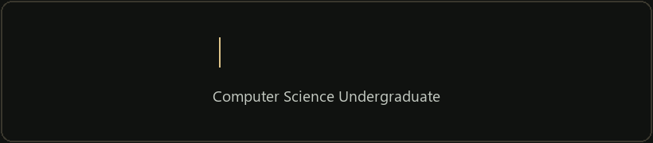

  

I'm **Niketha Thavaneswaran**, a Computer Science undergraduate at the **University of Vavuniya, Sri Lanka**.

- I enjoy working with **Python, machine learning, web development, and data analysis**.
- I learn by building projects and solving programming problems.
- I participated in **IEEEXtreme 18.0 and 19.0** and am an **AIESEC member**.
- I'm open to **internships and project collaborations**.

### My toolkit

**Languages:** Python · Java · HTML · CSS · PHP · SQL · MIPS Assembly  
**Data & ML:** Pandas · NumPy · Matplotlib · Scikit-learn  
**Tools:** Git · MySQL · VS Code · Jupyter Notebook · Google Colab

### Let's connect

[Portfolio](https://tniketha.github.io/Portfolio-Nikky/) · [Portfolio source](https://github.com/tniketha/Portfolio-Nikky) · [Email](mailto:tn.niketha@gmail.com)

<i>Always learning. Always building.</i>

